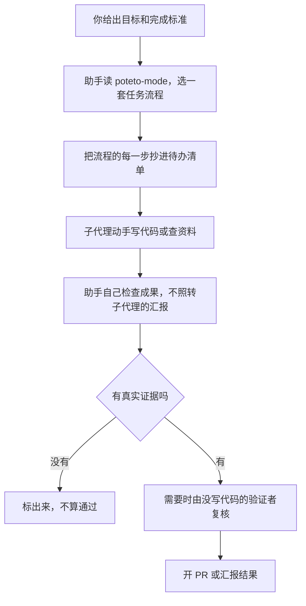

# pstack 深度解析：给 AI 编程助手立一套「先查清、再动手、做完要证明」的规矩

> 本文基于 pstack 0.15.28，写于 2026-10-25。当时 0.15.28 是本仓库 `pstack/` 目录所移植的官方版本，官方的最新版是 0.15.32。此后本仓库把 DSH 版同步到了 0.15.36，并新增了 `codex/` 目录里的 Codex 版。文中的数量和脚本清单仍是 0.15.28 的，没有重新统计。文中的事实都附了来源，标着「推断」的是本文自己的判断。数字可以用附录里的命令复核。

## 先看结论

AI 编程助手几分钟就能写出一大段代码，还能同时开好几个一起干。代价是没人来得及检查，助手说「做完了」，常常只是编译通过。pstack 是 Cursor 官方插件仓库里的一个插件，要解决的就是这件事。

**pstack 是一套写给 AI 编程助手看的工作规矩。它要求助手做完活以后拿真实证据来证明，并且让没写代码的人来验收。**

用法很短。你在对话框里输入 `/poteto-mode`，这是一条以斜杠开头的命令，再说清楚要做什么、怎么算做完。助手先判断这是修错误、加功能还是查问题，再照 23 套任务流程里对应的一套逐步办，每套流程是一份编号的步骤清单。没有合适的流程时，由它现场设计一套。每一步都要留下证据。

三个发现支撑这个判断。

- 它解决的是「AI 写得快，验得慢」。助手常常只看到「编译通过」就说做完了。pstack 要求修错误时贴出先失败、后通过的运行输出。在把一串改动合并进主分支的落地流程里，还要有一个没写这段代码的助手来验证。
- 它靠说明书运作，不靠程序强制。56 个技能和 23 套任务流程都是文本文件，可以理解成写给助手的说明书，会运行的只有几个小脚本。规矩能不能生效，取决于助手肯不肯照做。
- 和同类插件相比，它手动开启，不用时几乎不占助手的上下文空间。它主张先复现、先做原型，计划放在后面。它把验证写进了每一套流程。代价是流程重、费用高，还没有独立实验证明装了它效果更好。

本文的判断是，它值得在难 bug、迁移、性能优化和过夜任务上试用，不值得每个任务都开。下文按七个问题展开，依次是它是什么，解决什么问题，怎么用，为什么有效，和同类相比如何，有什么局限，该不该用。

## 一、pstack 是一套说明书加几个小脚本，不是会运行的程序

pstack 是一个开源插件，用 MIT 协议发布，可以自由使用和修改。作者是 Lauren Tan，网名 poteto。它放在 Cursor 官方的插件仓库 [cursor/plugins](https://github.com/cursor/plugins/tree/d457567332aa6989e753ea289f30ea2bfbc80bc0/pstack) 里，下文把这个仓库里的原版称为上游。

装上它以后，你电脑里多出来的是一批文本文件。最多的一类叫技能，英文是 skill。一个技能就是一份纯文本说明书，格式是 Markdown。助手读了它，就知道遇到某类事该怎么做。[Cursor 的文档](https://cursor.com/docs/skills)把技能定义为可移植、可纳入版本管理的包，用来教助手完成某类专门任务。

pstack 的构成如下。

| 部件 | 数量 | 作用 |
|---|---|---|
| 入口技能 `/poteto-mode` | 1 | 接收你的目标，挑一套任务流程，并规定所有任务共用的规矩 |
| 任务流程 | 23 | 英文叫 playbook。每套是一份编号步骤，比如修错误、加功能、盯着 PR 直到能合并 |
| 原则 | 24 | 每条是一个很短的文件，9 到 34 行。它们的名字就是纠偏用的口令，比如 prove it works |
| 单项技能 | 31 | 可以单独调用，比如 `/how` 讲清一段代码怎么工作 |
| 子代理角色 | 2 | 子代理是主助手派出去干活的另一个助手。`poteto-agent` 负责写代码，`comment-sicko` 专门删多余的注释 |
| 用户指南 | 10 章 | 上手教程和可以照抄的提示词 |
| 脚本 | 6 个 | 例如检查计划格式、轮询 PR 状态、记录进度、追加决策日志 |

PR 是把代码改动提交给团队审查的请求。上游 0.15.28 一共有 56 个技能，其中 1 个入口、24 条原则、31 个单项技能。[DeepSeek Harness](https://github.com/deepseek-ai/deepseek-harness) 是 DeepSeek 开源的 AI 助手运行环境，功能以插件的形式提供，下文简称 DSH，本仓库就是给它做插件的。仓库里的 DSH 移植版有 55 个技能，少的是依赖 Cursor 专有功能的 `make-bot-ui`。

pstack 以 Cursor 为主，同一套说明书也能装进 Anthropic 的编程助手 Claude Code，上游带了一份工具名对照表，见 [`docs/harness/claude-code.md`](https://github.com/cursor/plugins/blob/d457567332aa6989e753ea289f30ea2bfbc80bc0/pstack/docs/harness/claude-code.md)。本仓库再把它移植到了 DSH。

这 56 个技能里，只有 `setup-pstack` 允许助手自己想起来调用，其余 55 个都设成了只能手动调用。你不输入斜杠命令，它们就不会进入助手的上下文。上下文是助手一轮对话里能同时看到的文字，容量有限，所以常驻的说明越少越省。

## 二、它解决的是 AI 写得快、验得慢

pstack 的作者在 [README](https://github.com/cursor/plugins/blob/d457567332aa6989e753ea289f30ea2bfbc80bc0/pstack/README.md) 里写道 "i don't want to ship like a team of twenty slop artists. throughput without quality is not a goal i aspire to."。意思是只有产量、没有质量，不是作者想要的目标。具体看有四个麻烦，pstack 对每个都有对策。

第一个麻烦是助手说做完了，其实没验证。常见的情形是只看到「编译通过」就收工，或者直接转述子代理的汇报。原则 [Prove It Works](https://github.com/cursor/plugins/blob/d457567332aa6989e753ea289f30ea2bfbc80bc0/pstack/skills/principle-prove-it-works/SKILL.md) 要求对着真实的东西验证，原文是 "Do not infer from proxies, self-reports, or 'it compiles.'"。落到[修错误的流程](https://github.com/cursor/plugins/blob/d457567332aa6989e753ea289f30ea2bfbc80bc0/pstack/skills/poteto-mode/playbooks/bug-fix.md)里，就是先自己复现问题，修完在同一个环境里再跑一遍，并把先失败、后通过的输出原样贴进回复。

第二个麻烦是代码越写越多，越来越难审。作者的目标正相反，README 写的是 "the goal is not to maximize loc, in fact it's the opposite"。修错误的流程规定每一行改动都要能追溯到运行时的证据。它的原话是 "Belt-and-suspenders that 'might help' is a hypothesis, not a fix. It does not ship."，也就是说，「可能有帮助」的保险写法只算假设，不算修复，不交付。

第三个麻烦是想同时开多个助手，又怕互相踩。pstack 的办法是先做深，再并行，原话是 "if you want to go fast, go deep first."。每个子代理开工之前必须读完同一份规则，见 [`poteto-agent`](https://github.com/cursor/plugins/blob/d457567332aa6989e753ea289f30ea2bfbc80bc0/pstack/agents/poteto-agent.md) 的定义。用户指南还把「多个助手共用一个工作目录」列为[常见错误](https://github.com/cursor/plugins/blob/d457567332aa6989e753ea289f30ea2bfbc80bc0/pstack/docs/guide/10-recipes-and-pitfalls.md)，建议让它们在云端各自独立运行，或者要求每次尝试都用独立的工作目录。

第四个麻烦是总得盯着助手，反复纠正。pstack 让你只给目标和「怎么算做完」，步骤交给任务流程。中途跑偏时，一句话点原则的名字就能纠偏，比如 "apply prove it works. show me the real output, not the build log."。过夜的任务要先写明完成条件并记录决策日志，见[过夜运行一章](https://github.com/cursor/plugins/blob/d457567332aa6989e753ea289f30ea2bfbc80bc0/pstack/docs/guide/07-overnight.md)。

这些对策有没有被证实过？目前没有看到。第三方比较文章 [Dbggr](https://dbggr.dev/articles/agent-skill-libraries-compared/) 在 2026 年 10 月 14 日写道，没有对照研究测过装与不装这类技能库的差别。这篇文章由 AI 写成，只读了各库的文件，没有安装也没有运行。本文的推断是，这些做法在逻辑上对症，效果还得用你自己的任务来验。

## 三、用法很短，装好、配好、说一句话

最短的路径只有三步。

1. 安装。Cursor 里输入 `/add-plugin pstack`。Claude Code 里先输入 `/plugin marketplace add cursor/plugins`，再输入 `/plugin install pstack@cursor-plugins`，之后所有命令前面加 `/pstack:`。DSH 里运行 `dsh plugin --profile <profile> add /path/to/pstack-plugins/pstack`。
2. 配置模型。输入 `/setup-pstack`。它先问你的预算档位，分 unlimited、large、medium、small 四档，再为各个角色挑模型，结果写进一份配置文件。Cursor 写到 `~/.cursor/rules/pstack-models.mdc`，Claude Code 写到 `~/.claude/rules/pstack-models.md`，DSH 写进 `$DSH_HOME/AGENTS.md`。配置文件只对新对话生效，所以配完要新开一个对话。
3. 开工。输入 `/poteto-mode`，后面跟你的目标和验收标准。

一条好的提示最多包含五样东西，每样一句话就够，来自[用户指南](https://github.com/cursor/plugins/blob/d457567332aa6989e753ea289f30ea2bfbc80bc0/pstack/docs/guide/02-poteto-mode.md)。

- 目标，也就是哪里坏了，或者你想要什么。
- 完成标准，必须能判断通过或不通过。「做得更好一点」不算。
- 想看的证据，比如真实的命令输出、操作录屏、存下来的值，或者修改前后的数字。
- 已知线索，比如一个症状、一个复现步骤、一行日志或一个链接。
- 真实约束，比如「先复现」「先别改代码」「改完让我先看」。

下面三条提示都取自用户指南，英文原文可以直接照抄。

```text
/poteto-mode the csv export drops its last row since yesterday's deploy. failing job id is 4812. repro first, then fix. done means the 60k-row fixture exports every row. show me the row counts before and after.
```

这条的大意是，CSV 导出从昨天部署起少了最后一行，失败任务编号是 4812。先复现再修。做完的标准是 6 万行的测试数据全部导出，并给我看修复前后的行数。目标、完成标准、想看的证据和约束都在里面。

```text
/poteto-mode new task. figure out why the cache entry survives logout. don't change any code yet.
```

这条只查原因、不改代码。"new task" 让它重新选流程，不要接着上一个任务往下做。"don't change any code yet" 把它钉在只读调查的流程上。

```text
/poteto-mode im stepping away. keep going until the migration check reports zero old callers. log your decisions.
```

这条是过夜运行。完成条件是迁移检查报告零个旧调用方，并且要记录每个决定。

几个用法上的细节也值得记住。

- 别在提示里列技能顺序。写 "use /how, then /architect, then /arena" 通常会打乱任务流程本来排好的步骤。
- 先让助手复述问题，再说你的猜测。你先说猜测，助手就只去你指的地方找，`/in-your-own-words` 可以单独要一次复述。
- 想让 `/poteto-mode` 每一轮都生效，要用 Cursor 的自定义模式。在 `/` 菜单里选中它，按 Option+Enter，Windows 上按 Alt+Enter。普通回车只让它对这一条消息生效，见 [Cursor 的技能文档](https://cursor.com/docs/skills)。
- 不知道怎么用时，输入 `/poteto-help` 提问，它回答问题，不开工。

只想用其中一块，可以单独调用单项技能。

| 想做的事 | 输入 |
|---|---|
| 弄懂一段陌生代码是怎么工作的 | `/how` |
| 查它最近为什么坏了 | `/why` |
| 让几个不同的模型评审一个分支或一个设计 | `/interrogate` |
| 同一个任务做出几个候选方案，取长补短 | `/arena` |
| 把互不相干的检查分给多个子代理并行做 | `/swarm` |
| 去掉文字里的 AI 腔 | `/unslop` |
| 用大白话重述上一条回复 | `/bro` |

小改动不值得开。一行修改、已经知道怎么改的事、纯格式调整，直接让助手做就行。原因是费用。token 是模型计费的文字单位，多用 token 就是多花钱。pstack 自己的[设置指南](https://github.com/cursor/plugins/blob/d457567332aa6989e753ea289f30ea2bfbc80bc0/pstack/docs/guide/01-setup.md)承认它为子代理和评审小组多花 token。Cursor 的[子代理文档](https://cursor.com/docs/subagents)给了一个量级，同时跑五个子代理，大约花一个助手五倍的 token。

### 在 DSH 里使用

DSH 的用法和上面一样，差别有四处，都写在[移植版 README](../pstack/README.md) 里。

- 环境。移植版在 DSH 0.2.0-rc.2 上测过。另需 `git`、`rg` 和 `zstd`。PR 相关的流程要 `gh`，`watch-pr` 脚本要 `bun`。
- 启动方式。除了 `setup-pstack` 和 `typescript-best-practices`，其余技能都不出现在模型的技能目录里，要输入 `/<名字>` 才会启动，比如 `/poteto-mode`、`/how`。
- 模型。`deepseek-flash` 负责写代码和探索，`deepseek-v4-pro` 负责判断、文字和最难的任务。给不同子代理选不同模型，需要在 DSH 里打开子代理的模型选择。没打开时，所有子代理都用你当前的模型，`/setup-pstack` 写下的模型配置不起作用。默认的 `headless` 档案没有这个功能。
- 缺口。DSH 没有只读开关，只读子代理只靠提示词要求不改文件。DSH 也没有定时器，`/loop` 由目标功能和后台命令代替。

## 四、原理是一个前提加五个做法

### 一次任务怎么走



打个比方，这像一支装修队。

| 装修队 | pstack |
|---|---|
| 工序单 | 任务流程，每一步都抄进待办清单 |
| 工长 | 主助手，也就是收到 `/poteto-mode` 的那个对话。它负责计划、检查和汇报 |
| 工人 | 子代理，负责动手写代码或查资料 |
| 监理 | 验证者，一个没参与施工的助手 |
| 施工规范 | 24 条原则，每个子代理开工前都要读 |
| 验收看实物，不听口头汇报 | 做完要拿真东西证明 |

### 前提是规矩写在说明书里，没有程序拦着

pstack 里几乎所有规矩都是写给助手看的文字。助手肯照做，规矩就生效。助手偷懒，没有程序会拦它。按上游 0.15.28 的脚本清单，做硬检查的只有下面几处。

| 事项 | 由谁保证 |
|---|---|
| 多阶段计划文件的格式对不对 | 脚本 `check-plan.mjs`。格式有误就报错退出。多阶段计划是把大改动拆成几个依次合并的 PR 的计划文件 |
| PR 现在能不能合并 | 脚本 `watch-pr` 轮询 GitHub，读取检查和评审状态，给出 READY、WAITING 等结论 |
| 大型项目的任务和进度记录 | 脚本 `orch` 把任务和进度存成文本文件，它不负责启动任何助手。上游 0.15.36 已删除这个脚本 |
| 决策日志追加一行 | 脚本 `log.sh` |
| 选对任务流程、把步骤抄进待办清单 | 只靠助手自觉 |
| 验证者不是写代码的那个助手 | 只靠助手自觉。`watch-pr` 只读 GitHub 上的状态，不检查验证者的结论 |
| 回复里点名的原则是不是真读过 | 只靠助手自觉。脚本里没有任何地方检查原则 |
| 子代理用哪个模型 | 配置文件里写了，但由助手在派活时照着执行 |

另有两个辅助脚本。`worktree-audit.sh` 只读不删地给工作目录分类，`bootstrap.ts` 负责自动安装依赖。

靠说明书运作，在这类工具里很普遍。第三方 Productize 通读了 0.15.15 的全部技能并动手试用，结论是 "Only a handful of pieces in the whole plugin are real code you can run."，整个插件里能运行的代码只有少数几处，见[他们的评测](https://productize.life/blog/pstack-skills/en)。同类也是这样。gstack 的 README 说它的 23 位专家 "all slash commands, all Markdown"，Superpowers 的核心也是一批 Markdown 技能加会话启动钩子。这不算缺点，但读者要清楚，说明书能不能生效，取决于你用的助手和模型听不听话。这是本文的推断。

### 做法一，把流程写成清单，助手照单办事

入口技能 `/poteto-mode` 先做一件事，把你的话匹配到 23 套任务流程里的一套。

| 类别 | 数量 | 包含的流程 |
|---|---|---|
| 查问题 | 3 | 只读调查，查线上症状而不修，分析别人给的性能记录 |
| 改代码 | 7 | 修错误，加功能，重构，性能问题，反复逼近某个指标，像素级还原界面，做原型 |
| 交付 | 5 | 开 PR，盯着 PR 直到能合并，验证后落地，全自动处理一队 PR，处理一队 PR 但只交给你一串待落地 |
| 长任务 | 5 | 自主跑到完成，多天大项目的编排，写多阶段计划，接着上次的对话继续，安全暂停 |
| 维护 | 3 | 写或改技能，评测提示词或技能的改动，清理工作目录和磁盘 |

每套流程的英文名和步骤在 [`skills/poteto-mode/playbooks/`](https://github.com/cursor/plugins/tree/d457567332aa6989e753ea289f30ea2bfbc80bc0/pstack/skills/poteto-mode/playbooks) 目录里，文件名和流程同名。

有两种情况不走这 23 套。一是大型、跨很多处的改动，或者你要走开、事后才来验收的工作。二是没有合适的流程。这时助手改用 [`figure-it-out`](https://github.com/cursor/plugins/blob/d457567332aa6989e753ea289f30ea2bfbc80bc0/pstack/skills/figure-it-out/SKILL.md) 技能，现场为这次任务设计一套专用流程，见 [`poteto-mode`](https://github.com/cursor/plugins/blob/d457567332aa6989e753ea289f30ea2bfbc80bc0/pstack/skills/poteto-mode/SKILL.md) 的流程一节。

选定以后，助手把这套流程的每一步原样抄进待办清单，放在所有具体任务之前，原文是 "copied in verbatim, before any task-specific todos"。要跳过某一步，得在清单里写一行 `skip` 加上理由，让你看得见。本文的推断是，写成清单以后，漏了哪一步一眼就能看出来，这比让助手凭记忆办事可靠。

选错流程不会报错。没有任何代码在做匹配，选错只是助手没照说明书办。

### 做法二，做完要拿真东西证明

判断标准写在 Prove It Works 这条原则里。助手要看真实的输出、真实的值和真实的改动，不能靠代理指标，不能听汇报，也不能因为「编译通过」就收工。不同任务要交出的证据不一样。

| 任务 | 要交出的证据 |
|---|---|
| 修错误 | 先失败、后通过的复现输出，原样贴进回复 |
| 性能问题 | 修改前后的数字和产物路径 |
| 反复逼近某个指标 | 从起点到终点的差值 |
| 像素级还原界面 | 每个组件的差异比对结果 |
| 自主运行 | 完成条件最终的状态，加决策日志 |

有三个细节。第一，验证要在出问题的同一个环境里做。修错误的流程写明，结论不明确，或者在不对口的环境里验证，都不算通过，必须标出来，原文是 "Inconclusive" or wrong-surface is not a pass。第二，同一份流程还写着，单元测试只能说明某个分支的行为，不能说明错误已经消失。第三，助手回复里的每个论断，要么带着证据，要么标明是实测、推断还是猜测，见 [`poteto-mode`](https://github.com/cursor/plugins/blob/d457567332aa6989e753ea289f30ea2bfbc80bc0/pstack/skills/poteto-mode/SKILL.md) 的回复规则。

### 做法三，写代码的人不验收自己

最硬的一条规矩在[落地流程](https://github.com/cursor/plugins/blob/d457567332aa6989e753ea289f30ea2bfbc80bc0/pstack/skills/poteto-mode/playbooks/shipping.md)里。合并一串 PR 之前，每个 PR 都要有一个验证者把改动当用户那样跑一遍，并给出 `PASS`、`PASS+NOTES` 或 `FAIL`。原文是 "Only a verdict from an agent that did not write the code counts"，理由是作者检查的是自己想建的东西。CI 自动测试全绿和机器人评审通过也不算结论，因为它们都没有像用户那样把改动跑一遍。

其他几处用的是同一个思路。[`interrogate`](https://github.com/cursor/plugins/blob/d457567332aa6989e753ea289f30ea2bfbc80bc0/pstack/skills/interrogate/SKILL.md) 让几个不同的模型评审同一份改动，它的说明写着，找茬的信号来自模型的多样性，而不是给同一个模型分配不同角色。[`swarm`](https://github.com/cursor/plugins/blob/d457567332aa6989e753ea289f30ea2bfbc80bc0/pstack/skills/swarm/SKILL.md) 把检查分给多个子代理，最后只汇总成 `PASS`、`ISSUES`、`BLOCKED` 三种结果，缺了哪一块的结果，不能算通过。长时间无人值守的运行，交回之前要另派一个不同系列模型的子代理复核审计记录，[原文](https://github.com/cursor/plugins/blob/d457567332aa6989e753ea289f30ea2bfbc80bc0/pstack/skills/show-me-your-work/SKILL.md)说 "Self-review is not a substitute."。主助手自己也不转述子代理的汇报，要自己看改动、自己写总结。

这个思路不是 pstack 独有的。Cursor 的[子代理文档](https://cursor.com/docs/subagents)也给了一个验证者子代理的写法，说它要解决的是 AI 把任务标成完成、实现却不完整或有问题这种常见情况。本文的推断是，pstack 的增量在于把验证者预先接进了各套流程，并规定哪些节点必须有它，而不是发明了验证者。

### 做法四，先做深，再并行

这个做法来自作者的一句话，"if you want to go fast, go deep first."。深的意思是动手之前先弄清楚。修错误要先复现，再二分查原因。没有先例的设计，先做两三个原型再选，对应原则 Exhaust the Design Space。弄懂陌生代码用 `/how`，查它最近为什么坏了用 `/why`。

弄清楚以后才并行。README 说 pstack 给你 "fearless parallelism"，前提是每个子代理都读过同一份规则。`/arena` 让几个候选方案同时做，再由不同的模型互相评分，把各家的优点拼到一起。`/swarm` 把互不相干的检查分给多个子代理。用户指南建议并行的工作在云端各自独立运行，或者各用一个独立的工作目录，因为多个助手共用一个目录会互相覆盖。

不同的角色可以用不同的模型。`/setup-pstack` 让你为每个角色选模型。Cursor 上的默认搭配是 Grok 写代码，Claude Opus 负责最难的改动、文字和判断，见 [`poteto-mode`](https://github.com/cursor/plugins/blob/d457567332aa6989e753ea289f30ea2bfbc80bc0/pstack/skills/poteto-mode/SKILL.md) 的默认值。DSH 移植版换成了两个 DeepSeek 模型，见第三节的 DSH 小节。

### 做法五，用 24 条原则当共同语言

24 条原则分五组，通用 10 条，架构 6 条，验证 5 条，委派 2 条，元规则 1 条。每条的名字都能拿来纠偏。[用户指南](https://github.com/cursor/plugins/blob/d457567332aa6989e753ea289f30ea2bfbc80bc0/pstack/docs/guide/08-principles.md)的原话是 "You don't invoke principles. You use their names to steer."。助手偏了，你写一句 `apply prove it works` 就够了。

举几条看它们在管什么。Laziness Protocol 要求用最小的改动。Subtract Before You Add 要求先删掉没用的东西，再加新的。Prove It Works 要求对着真实的东西验证。Never Block on the Human 要求可撤销的事先做了再汇报，原文是 "Don't ask 'should I do X?' Do X, explain why."，但强制推送、删除生产数据这类不可撤销的操作，仍然要先确认。

助手的回复也有规矩。[`poteto-mode`](https://github.com/cursor/plugins/blob/d457567332aa6989e753ea289f30ea2bfbc80bc0/pstack/skills/poteto-mode/SKILL.md) 要求回复里点名哪条原则改变了哪个具体决定，并且只能引用本次会话里读过原文的原则。这条规矩没有程序检查，前面的表格已经列出。

## 五、和同类相比，pstack 手动开启、代码先行、验证写进流程

同类工具大致分两派。一派要求助手先把计划或规格写清楚再动手，Superpowers、gstack、Compound Engineering、GSD Core、Spec Kit 和 BMAD-METHOD 的默认路径都是这样，BMAD-METHOD 对明显的小改动例外。pstack 属于另一派。作者在 README 里说 "personally, i don't believe in planning. the best spec is code."，[用户指南](https://github.com/cursor/plugins/blob/d457567332aa6989e753ea289f30ea2bfbc80bc0/pstack/docs/guide/04-design.md)也提醒，给一份没有代码支撑的抽象计划做对抗评审，只会编出永远不会发生的风险。所以 pstack 的顺序是先复现、先做原型，设计定下以后才写计划。本文把这个差别叫作代码先行。

下表是八种做法的对比。各项目的版本和星标放在附录。

| 工具 | 默认起点 | 怎么启动 | 怎么把关「做完了」 | 代价 |
|---|---|---|---|---|
| [pstack](https://github.com/cursor/plugins/tree/d457567332aa6989e753ea289f30ea2bfbc80bc0/pstack) | 先复现、先做原型，计划放后面 | 手动输入 `/poteto-mode` | 要贴真实输出，落地前由没写代码的验证者给结论 | 子代理多，费用高，流程重 |
| [Superpowers](https://github.com/obra/superpowers) | 先头脑风暴，再写计划，再测试先行 | 自动，会话开始就注入 | 没有先失败的测试不许写代码，没有新跑出来的验证输出不许说做完 | 每个任务都走流程 |
| [gstack](https://github.com/garrytan/gstack) | 先梳理想法，再过多轮计划评审 | 手动输入斜杠命令，Claude Code 为主 | 计划的工程评审必过，装了另一家的命令行工具时默认再送它复核，可按需用真浏览器验证 | 命令多，安装重 |
| [Compound Engineering](https://github.com/EveryInc/compound-engineering-plugin) | 先头脑风暴和计划，约八成力气花在计划和评审 | 手动输入斜杠命令 | 多个评审角色并行，可选跨模型复核 | 重计划，重评审 |
| [GSD Core](https://github.com/open-gsd/gsd-core) | 把计划写成文件，分阶段推进 | 手动输入斜杠命令 | 动手前有计划检查器，做完后有验证者子代理对照目标检查 | 阶段制，小事显得官僚 |
| [Spec Kit](https://github.com/github/spec-kit) | 先写规格 | 手动输入斜杠命令，另有命令行工具 | 可选的检查关口，实现后对照规格收敛 | 完整一遍 9 步 |
| [BMAD-METHOD](https://github.com/bmad-code-org/BMAD-METHOD) | 小事直接做，大事先出文档 | 手动调用技能 | 实现后由独立评审者复查 | 大事的文档多 |
| 只用 Cursor 自带功能 | 由你决定 | 由你决定 | Plan 模式管计划，验证要你自己提要求 | 零安装，纪律靠自己 |

和 Superpowers 的差别最容易说清。两者都是一批 Markdown 技能，但 Superpowers 自己触发。Dbggr 指出，它在每次会话开始时注入一段说明，要求助手只要有「哪怕 1% 的可能」适用某个技能就必须用。Dbggr 按 pstack 0.15.24 估算，Superpowers 的常驻开销约 1,500 个 token，pstack 约 70 个，原因是 pstack 的技能几乎都要手动开启。Superpowers 还把测试先行写成铁律，原文是 "NO PRODUCTION CODE WITHOUT A FAILING TEST FIRST"，见它的 [TDD 技能](https://github.com/obra/superpowers/blob/v7.0.1/skills/test-driven-development/SKILL.md)。另一个[完成前验证技能](https://github.com/obra/superpowers/blob/v7.0.1/skills/verification-before-completion/SKILL.md)规定，没有新跑出来的验证证据，就不许声称做完。pstack 的 [`tdd`](https://github.com/cursor/plugins/blob/d457567332aa6989e753ea289f30ea2bfbc80bc0/pstack/skills/tdd/SKILL.md) 只在你明确要求，或者错误有明显且便宜的测试入口时才用。

gstack 的思路是让助手扮演一整家公司。它的 GitHub 简介写得很直白，23 个工具分别充当 CEO、设计师、工程经理、发布经理、文档工程师和 QA。工程评审是它唯一必过的关口，装好并登录另一家的命令行工具时，默认还会把计划和代码送给第二家模型复核，见[技能文档](https://github.com/garrytan/gstack/blob/main/docs/skills.md)。它也是同类里最重的，Dbggr 数过 57 个技能，安装还会往你的 `CLAUDE.md` 里加一段。

Compound Engineering 押的是积累。每做完一件事，它要求把学到的东西写进仓库的 `docs/solutions/`，下一轮头脑风暴和计划会先读这些记录。pstack 有对应的做法，形式不同。`/correct` 把同一个错误固化成架构、类型、检查规则或测试，让下一个助手犯不了这个错，而不是留一篇文档。

GSD Core 盯的是上下文变长以后质量下降，它的文档把这叫 context rot。办法是把计划写成 `.planning/` 目录下的文件，每个阶段交给一个全新上下文的子代理，不依赖一个越聊越长的对话，见[上下文工程一文](https://github.com/open-gsd/gsd-core/blob/v1.18.0/docs/explanation/context-engineering.md)。它的[阶段循环文档](https://github.com/open-gsd/gsd-core/blob/v1.18.0/docs/explanation/the-phase-loop.md)自己承认，阶段切得太小会显得官僚。选它时要认准新仓库，原仓库 gsd-build/get-shit-done 已经归档，社区在 open-gsd 组织下以 GSD Core 的名字继续维护。

Spec Kit 和 BMAD-METHOD 是规格派。Spec Kit 把规格当成源头，完整一遍有 9 步，其中 3 步是可选的检查关口。它的[复杂功能文档](https://github.github.io/spec-kit/concepts/complex-features.html)说，把大功能拆成「规格的规格」会带来最多的额外开销。BMAD 的[规划文档](https://docs.bmad-method.org/plan/choose-a-planning-path/)写明，明显的低风险小改动不需要它。Scott Logic 的 CTO Colin Eberhardt 在 2025 年 11 月用 Spec Kit 给自己的业余项目 KartLog 加定位功能，结论偏负面，他写道不用规格流程自己效率高得多，大约快十倍，见[他的文章](https://blog.scottlogic.com/2025/11/26/putting-spec-kit-through-its-paces-radical-idea-or-reinvented-waterfall.html)。这只是单人、单个业余项目的个案，Spec Kit 此后也已更新多个版本，但它说明重流程的开销可能很大。

不装任何插件，Cursor 自己也有相关功能。[Plan 模式](https://cursor.com/docs/agent/plan-mode)先问澄清问题、查代码库，再生成可以编辑的计划，然后才动手。内置技能里有 `/autopilot` 盯着 PR 处理反馈和失败的检查，`/review` 做代码评审，[技能文档](https://cursor.com/docs/skills)列出了全部。[子代理](https://cursor.com/docs/subagents)有独立上下文，可以并行，可以指定模型和只读。这些功能是分开的，怎么组合成一套「做完要证明」的流程要你自己来。本文的推断是，pstack 的价值主要在这套已经组合好的流程，而不在某一项功能。

怎么选，看你的处境。

- 只在 Cursor 里工作，只想在难任务上开一套严格模式，选 pstack。
- 想让助手在每个任务上都自动走固定流程，团队统一做法，选 Superpowers。
- 重度使用 Claude Code，做产品，要真浏览器测试，选 gstack。
- 想把每次学到的东西写进仓库，让下一次直接用上，选 Compound Engineering。
- 一个项目会跨很多次对话，担心助手越聊越糊涂，选 GSD Core。
- 需要先对齐需求、留下文档给别人看，选 Spec Kit 或 BMAD-METHOD。
- 小改动，或者已经有自己的做法，不装，直接用 Cursor 自带的 Plan 模式。

前面说过，目前没有对照实验证明这几个工具里的任何一个让助手变好。Dbggr 的建议是同类工作流库最多装一个，装之前用自己的任务对比装与不装。它读了每个库的文件并用脚本量了体积，没有安装也没有运行，所以能支撑关于结构和成本的结论，支撑不了关于效果的结论。

## 六、局限有六处，核心是规矩靠自觉、费用高、换平台会打折

第一，规矩靠自觉，没有程序兜底。第四节的表格已经列出，选流程、验证者独立、原则引用都没有程序检查。Productize 的试用还发现，`watch-pr` 报告 READY，意思只是检查全绿、没有未处理的评审讨论。那个仓库没有要求任何人评审，所以 READY 不等于有人看过。这是脚本的设计，不是错误，但读的人要清楚。

第二，流程重，费用高。原因和量级见第三节。设置指南推荐的省钱办法是重跑 `/setup-pstack`，选更低的预算档位，或者主对话用强模型、写代码的角色用便宜又快的模型。

第三，Cursor 上最完整，换平台会打折。上游的 Claude Code 对照表写明，Claude Code 没有 Cursor Automations、Bugbot、Cursor 云端子代理和内置的 PR 工具。遇到需要这些的步骤，助手只写一行 `Skipped in Claude Code: <步骤>. <原因>.` 就往下走。非 Claude 的模型名一律省略，子代理改用当前会话的模型。本文的推断是，多模型评审在 Claude Code 里会退化成同一个模型。DSH 移植版同样有折扣，见第三节。

Claude Code 上的这个折扣还缺少实测。Productize 在 10 月 14 日的试用里，`arena` 和 `interrogate` 在 Claude Code 里没能运行，但那早于官方对照表，对照表的第一次提交在 10 月 16 日，现状没有复测。

第四，更新很快，几乎是一个人在维护。到提交 99b609a 为止，`pstack/` 目录有 162 次提交，其中 156 次来自同一位作者，占 96%，2026 年 8 月 31 日以来就有 87 次。技能数也在涨，第三方读到的 0.15.15 有 51 个，0.15.28 有 56 个，0.15.32 有 58 个。`sharpen` 技能在 10 月 13 日加入，18 日删掉一条限制，19 日又恢复成原来的写法。本文的推断是，技能的行为会在几天内变化，方向也由一个人的偏好决定。想用就固定版本，升级前读变更。作者在 README 里的邀请是 "fork it. improve it. make it yours."。

第五，它反对先写计划，需要留下设计文档的团队要自己补。pstack 不要求先写规格，所以不会自动留下一份给别人看的设计文档。需要时可以明确要求多阶段计划流程，它会产出一份计划文件，用脚本检查格式，并且在你说 go 之前不开工，见[该流程](https://github.com/cursor/plugins/blob/d457567332aa6989e753ea289f30ea2bfbc80bc0/pstack/skills/poteto-mode/playbooks/multi-phase-plan.md)。

第六，没有独立的效果证据。前文已经说过，没有对照实验证明装了它效果更好。想知道对你有没有用，只能拿自己的任务试，做法见下一节。

## 七、值得在难任务上试，不值得全程开着

适合用的情形有四种，难 bug、迁移、性能问题和过夜任务。它们的共同点是结果能检查，做错的代价也高于多花的 token。Flavio Copes 的用法也是这几类，他在[文章](https://flaviocopes.com/pstack/)里写明不会给每个改动都开完整流程，改一个日期或一句话，不值得动用多个模型、方案评比和决策日志。

不适合的情形有四种。一行改动，或者已经知道怎么改的事。想让助手在每个任务上自动走固定流程的团队，这是 Superpowers 的路子。需要正式规格文档的团队。不能用子代理或多模型的环境。

想试的话，按四步走。

1. 装好，运行 `/setup-pstack`，预算先选 medium 或 small，这两档推理更少，花的 token 也更少。
2. 挑一个真实的、做错了会心疼的任务，输入 `/poteto-mode`，写上目标、完成标准和想看的证据。
3. 看待办清单里出现了哪些步骤，回复里有没有贴出真实输出。没有贴，说明这一次规矩没生效。
4. 用一周。同一类任务各做一次，开与不开，比较有没有证据、花了多少 token、你审查花了多久，再决定保留什么。只想要一部分，就单独用 `/how`、`/interrogate` 这些单项技能。Productize 的建议是，已经有自己的工作方式时，拿工具，不要拿管理者。

本文的看法是，最值得借鉴的是两个习惯，验证者不能是作者，计划放在原型之后。这两条不装 pstack 也能用，23 套流程倒在其次。这是推断。

## 附录

### 版本

| 项目 | 版本 | 说明 |
|---|---|---|
| 上游 pstack，本文依据 | 0.15.28 | 提交 `d457567332aa6989e753ea289f30ea2bfbc80bc0`，本仓库的同步记录日期是 2026-10-19 |
| 上游 pstack，撰写时最新 | 0.15.32 | 提交 `99b609a72323`。`pstack/` 目录比 0.15.28 多 17 次提交，新增 2 个技能，是 `statechart` 和 `ketchup-video` |
| 本仓库的 DSH 移植版 | 写作时 0.15.28-dsh.1，现为 0.15.36-dsh.1 | 见 [`pstack/README.md`](../pstack/README.md)。同步到更新的上游版本后，第一节的数量需要重新统计 |

### 竞品版本与星标

下表是 2026-10-25 查到的值。星标只代表关注度，不代表好用。pstack 没有独立的星标，它所在的 cursor/plugins 仓库有 1.4 万，这个数字由里面所有官方插件共享。

| 项目 | 最新版本 | GitHub 星标 |
|---|---|---|
| pstack | 0.15.32，本仓库移植的是 0.15.28 | 无独立数字 |
| Superpowers | v7.0.1，2026-10-21 | 30.5 万 |
| Spec Kit | v1.2.3，2026-10-22 | 14.3 万 |
| gstack | 1.91.201.0，2026-10-25，没有 GitHub Release | 13.8 万 |
| BMAD-METHOD | v6.12.4，2026-10-14 | 5.5 万 |
| Compound Engineering | compound-engineering-v3.32.1，2026-10-25 | 2.6 万 |
| GSD Core | v1.18.0，2026-10-19 | 1.1 万，旧仓库 6.4 万已归档 |

### 复核命令

上游 0.15.28 的数量，以及到 99b609a 为止的提交统计。

```sh
git clone --filter=blob:none https://github.com/cursor/plugins.git
cd plugins
git checkout d457567332aa6989e753ea289f30ea2bfbc80bc0
find pstack/skills -name SKILL.md | wc -l          # 56
ls -d pstack/skills/principle-* | wc -l            # 24
ls pstack/skills/poteto-mode/playbooks | wc -l     # 23
git log --oneline 99b609a72323 -- pstack/ | wc -l                          # 162
git log --since=2026-08-31 --oneline 99b609a72323 -- pstack/ | wc -l      # 87
git log --format=%an 99b609a72323 -- pstack/ | sort | uniq -c | sort -rn  # lauren 156
```

本仓库移植版的数量，在仓库根目录运行。

```sh
find pstack/skills -name SKILL.md | wc -l          # 55
```

星标会随时间变化，查询方式如下。

```sh
for r in obra/superpowers garrytan/gstack EveryInc/compound-engineering-plugin open-gsd/gsd-core github/spec-kit bmad-code-org/BMAD-METHOD cursor/plugins; do
  echo "$r $(gh api repos/$r --jq .stargazers_count)"
done
```

### 来源

pstack 的所有引文都来自提交 `d457567332aa` 下的 `pstack/` 目录，文中的链接已固定到这个提交。

竞品的一手来源，2026-10-25 访问。

- Superpowers，[仓库](https://github.com/obra/superpowers)，技能文件取自标签 v7.0.1。
- gstack，[仓库](https://github.com/garrytan/gstack)和[技能文档](https://github.com/garrytan/gstack/blob/main/docs/skills.md)。
- Compound Engineering，[仓库](https://github.com/EveryInc/compound-engineering-plugin)。
- GSD Core，[仓库](https://github.com/open-gsd/gsd-core)，文档取自标签 v1.18.0。
- Spec Kit，[仓库](https://github.com/github/spec-kit)和[官方文档](https://github.github.io/spec-kit/)。
- BMAD-METHOD，[仓库](https://github.com/bmad-code-org/BMAD-METHOD)和[官方文档](https://docs.bmad-method.org/)。
- Cursor 官方文档，[Plan 模式](https://cursor.com/docs/agent/plan-mode)、[技能](https://cursor.com/docs/skills)、[子代理](https://cursor.com/docs/subagents)。

第三方来源。

- [Dbggr](https://dbggr.dev/articles/agent-skill-libraries-compared/)，2026-10-14，读的是 pstack 0.15.24。文章由 AI 写成，静态分析，没有安装也没有运行。
- [Productize](https://productize.life/blog/pstack-skills/en)，2026-10-13 发表，10-15 更新，读的是 pstack 0.15.15，当时上游是 0.15.21。团队实际动手移植和试用。
- Flavio Copes，[pstack 深度介绍](https://flaviocopes.com/pstack/)，更新于 2026-09-29。
- Colin Eberhardt，[Spec Kit 试用](https://blog.scottlogic.com/2025/11/26/putting-spec-kit-through-its-paces-radical-idea-or-reinvented-waterfall.html)，Scott Logic 的 CTO，2025-11-26。

没有采用的来源。Reddit 上两个讨论 pstack 的帖子，抓取时返回 403，没有读到正文，所以没有引用。
